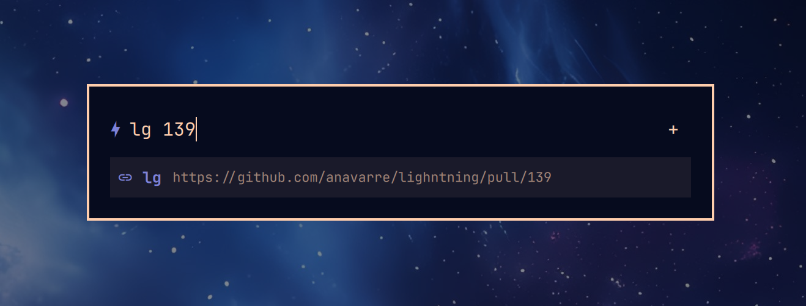

# Omarchy Lightning



A keyword launcher for the Omarchy shell. Summon it, type a trigger, press
Enter: its URL opens in your default browser. Add `{}` or `%s` to a URL and
the text you type after the trigger is filled in, e.g. `lg 123` to open
your Github PR #123 for the Lightning project.

## Requirements

- Omarchy with the Quickshell-based shell (`omarchy-shell`)
- `omarchy-launch-browser` and `omarchy-launch-editor` (part of Omarchy)
- For the tests only: `bash`, `python3`, `node`

## Easy install

Install from the Omarchy Marketplace.

```sh
omarchy plugin add https://github.com/anavarre/omarchy-miniflux.git --enable
```

## Manual Install

```sh
git clone https://github.com/anavarre/lightning ~/.config/omarchy/plugins/anavarre.lightning
omarchy plugin validate ~/.config/omarchy/plugins/anavarre.lightning
omarchy plugin enable anavarre.lightning
omarchy-shell shell rescanPlugins
```

### Update

```sh
git -C ~/.config/omarchy/plugins/anavarre.lightning pull
omarchy-restart-shell
```

### Hotkey

Add to `~/.config/hypr/bindings.lua`:
```lua

o.bind("CTRL + ALT + SPACE", "Lightning", "omarchy-shell shell summon anavarre.lightning")

Any key works; the command is the part that matters. It also works from a
script or another tool: `omarchy-shell shell toggle anavarre.lightning`.

### Bar icon (optional)

The launcher works without a bar icon. To add the ⚡ button:

```sh
omarchy bar put anavarre.lightning --section left     # or center, right
omarchy bar move anavarre.lightning --section center  # move it later
```

## Configuration

The first time the launcher opens, Lightning creates `~/.config/lightning/lightning.conf`
(respects `$XDG_CONFIG_HOME`) with a commented-out template. Lightning never
writes to the file again. If you delete it, a fresh template is created the
next time the launcher opens.

Click **+** in the launcher to open the file in your default editor. Changes
apply as soon as the file is saved; there is nothing to reload.

```ini
# Plain bookmarks
gh   = https://github.com
mail = https://app.hey.com
wiki = www.wikipedia.org

# With a placeholder
ddg  = https://duckduckgo.com/?q=%s
yt   = https://www.youtube.com/results?search_query={}
```

- One `trigger = URL` per line. Spaces around `=` are optional.
- A line starting with `#` or `;` is a comment. `[section]` lines are ignored.
- A URL is anything of the form `scheme://…` (`https://…`, `obsidian://…`)
  or anything starting with `www.`, which gets `https://` added. Schemes
  without `//`, such as `mailto:`, are not recognized, and `javascript:`,
  `data:` and `vbscript:` URLs are rejected as a safety measure. A line whose
  value isn't a URL is silently skipped, so check for typos if a trigger
  doesn't show up.
- Only the first `=` splits the line, so URLs may contain `=`
  (`?a=1&b=2`).
- Triggers are case-insensitive and cannot contain spaces (a space marks the
  start of the placeholder text). A trigger defined twice keeps its last URL.

### Placeholders

Put `{}` or `%s` in a URL, then type the trigger, a space and your text:

| you type | config line | opens |
|---|---|---|
| `ddg omarchy plugins` | `ddg = https://duckduckgo.com/?q=%s` | `…/?q=omarchy%20plugins` |
| `gh` | `gh = https://github.com` | `https://github.com` |

- Everything after the first space is the placeholder text. Leading and
  trailing spaces are trimmed; spaces inside are kept (`two words`).
- The text is URL-encoded, so spaces, `&`, `?`, `#` and `/` are safe in a
  query string. It also means a `/` becomes `%2F`: a placeholder can fill one
  path segment, not several.
- Every placeholder in the URL gets the same text.
- The results list previews the expanded URL as you type.
- Press Enter or Tab on a placeholder trigger with no text yet and Lightning adds
  the space and waits, instead of opening a URL with an empty gap.
- Text typed after a trigger whose URL has no placeholder is ignored; the URL
  opens as-is.

`{}` and `%s` are equivalent. `%s` matches browser keyword bookmarks, so
those can be pasted in unchanged.

## Using it

Typing shows matching triggers, best first: exact match, then triggers that
start with what you typed, then triggers that contain it (up to 8). Only the
part before the first space is matched, so `ji ABC-123` also finds `jira`.

| key | action |
|---|---|
| Enter | open the selected URL |
| Up / Down, Ctrl+P / Ctrl+N | move the selection |
| Tab | complete the selected trigger (plus a space if it takes a placeholder) |
| Escape | clear the field; press again to close |

The mouse works too: hover a row to select it and click to open it. Clicking
outside the card closes the launcher.

## Troubleshooting

| symptom | fix |
|---|---|
| hotkey or bar icon does nothing | `omarchy plugin list --json \| jq '.[]\|select(.id=="anavarre.lightning")'` should show `"enabled": true`; if not, `omarchy plugin enable anavarre.lightning` |
| a trigger doesn't appear | its value isn't recognized as a URL (needs `scheme://` or `www.`), or the line is commented out |
| the placeholder stays as `{}` | type a space after the trigger, then your text |
| a code change has no effect | `omarchy-restart-shell`; errors land in `qs log -p /usr/share/omarchy/shell --tail 100` |

`active: false` in `omarchy plugin list` is normal; check `enabled` instead.

## Remove

```sh
omarchy plugin disable anavarre.lightning
rm -rf ~/.config/omarchy/plugins/anavarre.lightning ~/.config/lightning
```

Also remove the hotkey from `bindings.lua`.

## Tests

```sh
tests/run
```

Checks the manifest, shell syntax, config parsing, placeholder expansion and
first-run config creation. Writes only to a temporary directory.

## License

MIT. See [LICENSE](LICENSE).
